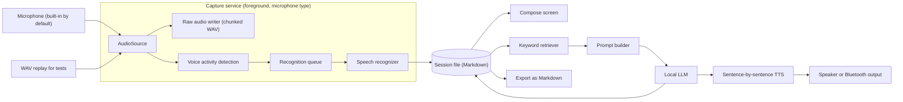

# Architecture

Two rules drive everything:

1. **Raw audio is written first.** Transcription may lag behind and catch up; audio is never dropped.
2. **The capture path never waits on the LLM or TTS.**

## Modules

| Module | Contains | Rules |
| --- | --- | --- |
| `android/core` | Session entries, session format reader/writer, `CapturePipeline` (source, raw audio, VAD, recognition queue, session store), interfaces (`AudioSource`, `RawAudioSink`, `VoiceActivityDetector`, `SpeechRecognizer`, `SessionStore`, `LlmEngine`, `Retriever`, `TextToSpeaker`) | Pure Kotlin/JVM. No Android imports, no third-party runtime dependencies, no coroutines (ADR-0002) |
| `android/app` | Compose UI, `CaptureService`, Android implementations (AudioRecord, Android TTS, MediaSession), native bridges | The service owns the pipeline; the UI only observes |
| `tools` | `voicetools` Python package: session parser and linter, planted-fact scorer | No runtime dependencies |
| `fixtures` | Shared session files used by both parsers | Read-only ground truth |

## Pipeline states

`Idle`, `Recording`, `Thinking` (question in progress), `Speaking`, `Paused` (capture suspended with a gap marker), `Stopped`,
`Error`. Capture must never depend on the LLM: an LLM failure is logged as a marker and recording continues.

## Interface note

The interfaces in `android/core/.../Interfaces.kt` are sketches from the plan. They use blocking calls and callbacks so
`core` stays dependency-free; Flow wrappers belong in `app`. Change them only with human approval.
