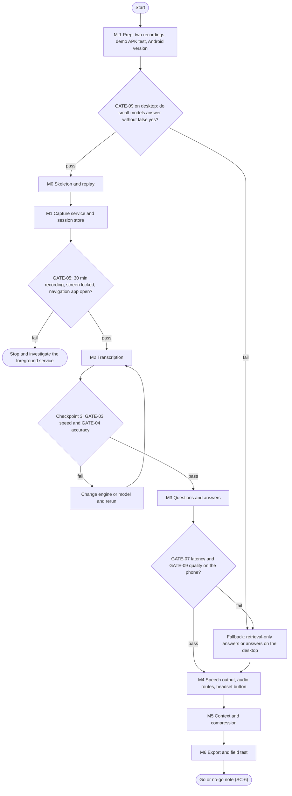
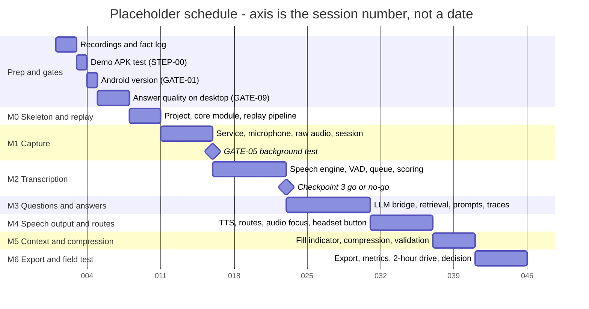
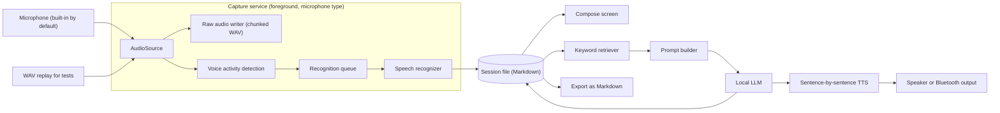
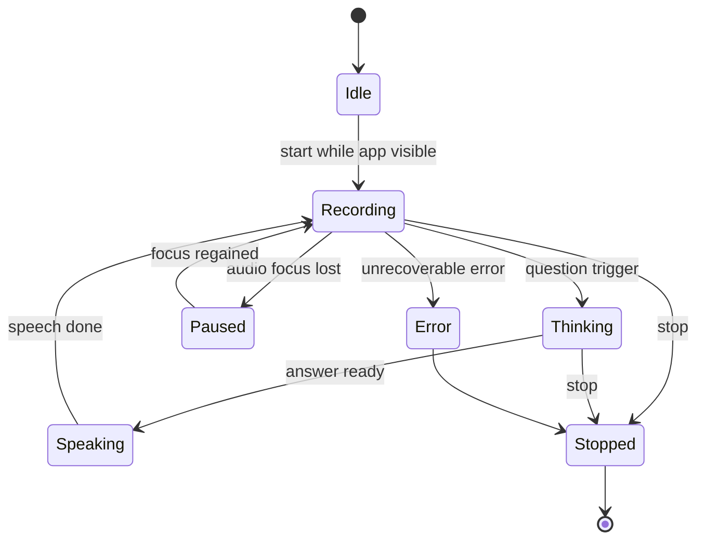
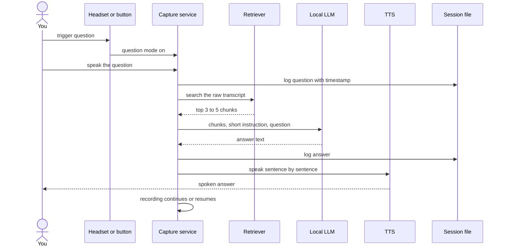

# POC Project Plan: Offline Voice Capture App for Android

Owner: Martin · Target device: Google Pixel 7 · Status on 18 November 2026: plan only, nothing built or measured.
IDs such as GATE-05 and STEP-18 refer to the detailed doc “POC Plan: Offline Voice Capture App (Android)”, sections 10 to 14.

## 1. Objective and success criteria

**Objective:** find out with measurements, using a deliberately small first build, whether a Pixel 7 can transcribe long rambling speech offline, answer short spoken questions about it from a small local LLM, and hand over a raw session file for desktop processing.

Success criteria (proposed thresholds, confirm before measuring):

1. **SC-1** A 2-hour drive session is recorded with the screen locked and a navigation app open, with no gap, crash or process kill.
2. **SC-2** At least 90% of the planted numbers, names and codes are correct in the desk-recording transcript.
3. **SC-3** Zero false “yes” answers on the three never-said questions.
4. **SC-4** At least 6 of 7 factual questions are answered correctly by the model that runs on the phone.
5. **SC-5** Time from the end of a question to the first spoken word is 15 seconds or less (marginal up to 30).
6. **SC-6** A one-page go/no-go note exists, listing what failed or was relaxed.

## 2. Scope

In scope:

1. Continuous offline transcription into a timestamped Markdown session file, with the raw audio kept.
2. Questions to a local LLM on demand; answers are logged in the session and read aloud.
3. A context fill indicator and a user-triggered compression step with explicit markers.
4. Export of the raw session as Markdown.

Out of scope for the POC:

1. German (stretch goal after English works).
2. Streaming LLM output.
3. Automatic Google Drive upload.
4. Summary documents on the phone (condensing happens later on the desktop).
5. UI polish and embedding-based search.

## 3. Project flow and gates

Every milestone ends in a pass or fail check, and every failure has a defined fallback. Measurement comes before building.

## 4. Milestones and deliverables

| Milestone | Deliverable | Exit check |
| --- | --- | --- |
| M-1 Prep and measurement | Desk and car recordings with fact log, demo APK test, Android version noted, desktop answer-quality results | GATE-01, GATE-02, GATE-09 |
| M0 Skeleton and replay | App builds; session format and replay pipeline pass unit tests with fake components | Review checkpoint 1 |
| M1 Capture | Foreground service records with the screen locked; raw audio and session file survive a force-stop | GATE-05, checkpoint 2 |
| M2 Transcription | Speech engine and voice detection on the phone, scored on the recordings | GATE-03, GATE-04, checkpoint 3 |
| M3 Questions and answers | Local LLM answers typed and spoken questions, with a debug trace for each | GATE-06, GATE-07, GATE-09, checkpoint 4 |
| M4 Speech output and routes | Answers spoken sentence by sentence; audio routes tested; headset button mapped | GATE-10, checkpoint 5 |
| M5 Context and compression | Fill indicator; marked compression; desktop validation of the summary | Checkpoint 6 |
| M6 Export and field test | Share-sheet export; metrics log; 2-hour drive; go/no-go note | SC-1 to SC-6 |

## 5. Schedule (placeholder)

The chart shows order and relative size, not calendar dates. The axis counts sessions: one session is one focused sitting of about 3 hours, which is my assumption. The total is about 45 sessions, roughly 135 hours; at 10 hours a week, for example, that is about 3 months. I don’t know your weekly hours or your Android experience, and either could move this a lot. Re-estimate after M0.

## 6. Gates and fallbacks

| Gate | Check | Pass | Marginal | Fail |
| --- | --- | --- | --- | --- |
| GATE-03 | Speech speed (real-time factor) | Below 0.5 | 0.5 to 1.0 | Above 1.0, or audio dropped |
| GATE-04 | Planted numbers, names and codes correct | 90% or more | 75% to 90% | Below 75% |
| GATE-05 | 30 minutes recorded, screen locked, navigation app open | No gap, no kill | none | Any silent stop |
| GATE-07 | Time to first spoken word, 1,500-token prompt | 15 s or less | 15 to 30 s | Above 30 s |
| GATE-09 | Answer quality on the 11 test questions | Zero false yes on questions 9 to 11, at least 6 of 7 factual correct | none | Any false yes, or fewer than 5 of 7 factual correct |

Fallbacks:

1. **Speech fails:** change the engine or model and rerun. If every candidate fails, the phone only records audio and the desktop does all transcription.
2. **GATE-05 fails:** stop. The whole product depends on background recording.
3. **LLM gates fail:** use retrieval-only answers (the app finds the best-matching passage and reads it aloud, with no generation), or answer questions on the desktop after the drive.
4. **GATE-07 marginal:** try a smaller model, fewer retrieved chunks, or a short audio cue while waiting.

## 7. Architecture

Two rules drive the design: raw audio is written first, so transcription can lag safely, and the capture path never waits on the LLM or TTS.

## 8. Runtime behavior

States of the pipeline. “Paused” means capture is suspended with a gap marker written (for example a phone call took audio focus).

The question flow, from trigger to spoken answer:

## 9. Work breakdown

| Workstream | Key tasks | Detailed steps |
| --- | --- | --- |
| Measurement and test data | Recordings, planted-fact log, scoring script, results log | TASK-00-7, STEP-16, STEP-17, STEP-35 |
| Capture and session | Foreground service, microphone source, raw audio writer, session store | STEP-06 to STEP-10 |
| Speech recognition | Voice detection, recognizer wrapper, queue | STEP-11 to STEP-15 |
| LLM and retrieval | Native build, engine wrapper, chunker and retriever, prompts, debug traces | STEP-18 to STEP-26 |
| Speech output and routes | TTS, route policy, audio focus, headset button | STEP-27 to STEP-32 |
| Context and compression | Fill indicator, marked compression, validation | STEP-33 to STEP-35 |
| Export, metrics, field test | Share sheet, memory and thermal log, 2-hour drive, decision note | STEP-36 to STEP-39 |

## 10. Risks

Ratings are my judgment, not measurements.

| ID | Risk | Likelihood and impact | Early warning | Response |
| --- | --- | --- | --- | --- |
| R1 | Local LLM too slow on the Tensor G2 (no Pixel 7 benchmark found) | High, high | GATE-06 and GATE-07 numbers | Smaller model, retrieval-only answers, or answers on the desktop |
| R2 | Small model gives false “yes” answers | High, high | GATE-09 fails on the desktop | Stricter prompt, retrieval-only answers, no LLM on the phone |
| R3 | Speech too slow or inaccurate, especially with road noise | Medium, high | GATE-03, GATE-04, car recording | Other engine or smaller model; desktop transcription |
| R4 | Android stops background recording | Medium, critical | GATE-05 | Review service setup and battery settings; otherwise stop |
| R5 | Bluetooth route gives poor microphone quality | Medium, medium | GATE-10 | Built-in mic with Bluetooth output, or a wired headset |
| R6 | Native library integration eats the schedule | High, high | STEP-11 or STEP-21 overruns | Start from library examples; time-box; Android experience unknown |
| R7 | Scope creep, and a plan that is heavy on text and light on measurement | High, medium | Recordings still not made | Do the M-1 steps first; keep the out-of-scope list |
| R8 | Library or API changes break the build | Medium, medium | Build fails after an update | Pin versions; keep a results log |
| R9 | Heat when charging and running both models | Medium, medium | Thermal log in GATE-08 | Skip LLM work at high thermal status |

## 11. Working process

1. Keep the project in version control and tag each review checkpoint.
2. Keep one results log with the gate, date, device, Android version, tool versions, model files and raw numbers.
3. Pin library, model and tool versions in one text file.
4. Keep the recordings, the 11 questions and the scoring scripts as a fixed regression set and rerun them after every model or engine change.
5. Review checkpoints: 1 after STEP-05, 2 after STEP-10, 3 after STEP-17, 4 after STEP-26, 5 after STEP-32, 6 after STEP-35.
6. Stop conditions: GATE-05 fails; no small model passes GATE-09 and retrieval-only answers are not acceptable; GATE-07 fails and answers after the drive are not acceptable.

## 12. Open decisions

1. Keep a separate desktop prototype (Phase 0 of the detailed plan) or drop it.
2. Confirm or change the proposed thresholds before measuring.
3. How many working hours per week you can give this, which sets the schedule.
4. Whether German moves into the POC after M2.
5. Whether streaming answers stay out of the POC.
6. The minimum Android version, after reading your phone’s version.
7. Whether retrieval-only answers become a planned feature instead of only a fallback.

## 13. Assumptions and unknowns

1. Nothing has been measured on the Pixel 7, and no Tensor G2 LLM benchmark was found.
2. Durations are my guesses and assume no prior Android experience, which I don’t know.
3. Library details (speech engine, llama.cpp, TTS, media session) come from secondary sources and must be verified.
4. All thresholds are proposals.
5. Risk ratings are my judgment.
6. The Android version of the phone is unknown.

## 14. Next four actions

1. Record the desk and car sessions with the planted facts.
2. Try a pre-built sherpa-onnx demo APK with the recording (STEP-00).
3. Run the answer-quality test on the desktop (STEP-18, GATE-09).
4. Note the phone’s Android version (GATE-01).
